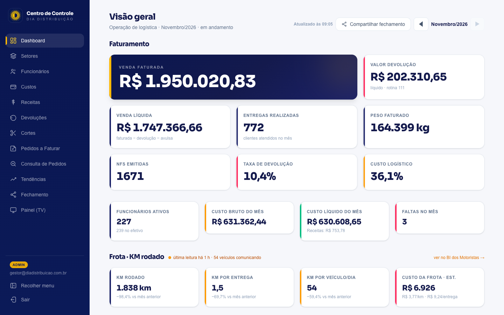
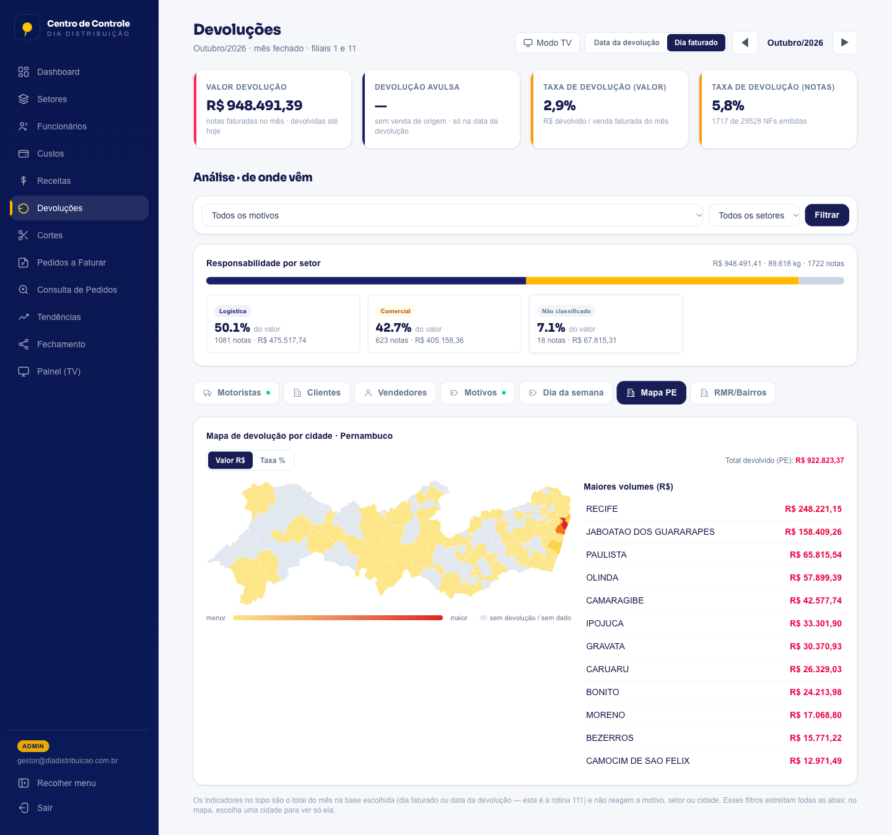
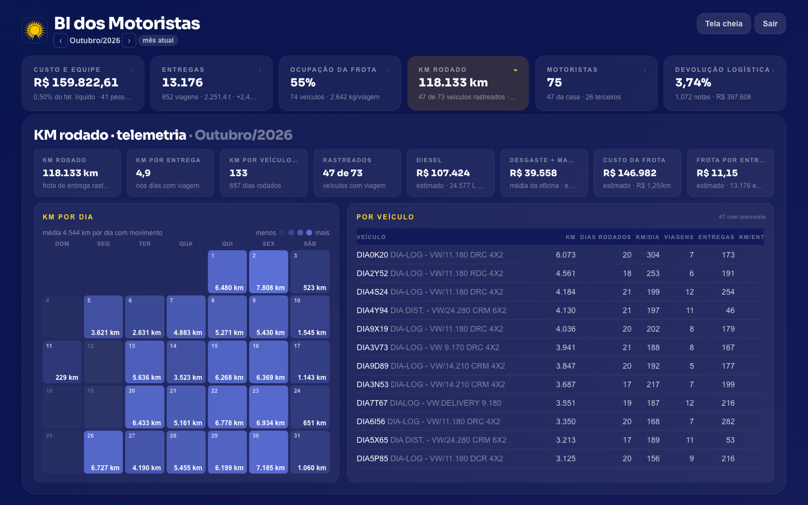
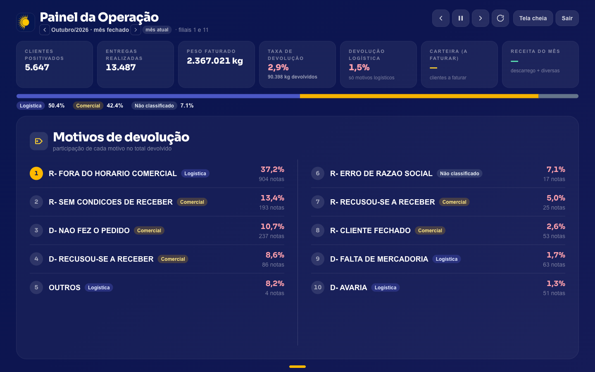
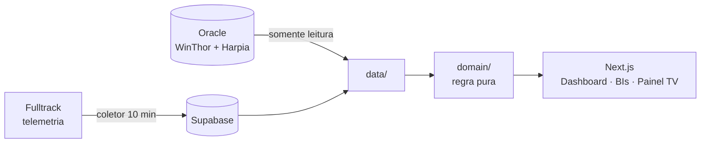

<div align="center">


# Centro de Controle Logística

**A operação inteira da distribuição numa tela só.**
Faturamento, devoluções, frota, pedidos, efetivo, custos e receitas, lidos ao vivo do ERP e do WMS.


<br/>



</div>

> [!NOTE]
> Projeto desenvolvido sob medida para a **DIA Distribuição**.
> **Todas as imagens deste README usam dados mascarados**: valores, nomes e placas
> foram trocados. Credenciais e acessos (Supabase, Oracle) ficam só em variáveis de
> ambiente (`.env.local`, no `.gitignore`). O repositório não guarda chaves, senhas
> nem dados reais.

---

## ✨ Por que existe

A gestão logística vivia espalhada em planilhas, rotinas do ERP e relatórios do WMS
que ninguém cruzava. O **Centro de Controle** junta tudo:

- 🔌 **ERP Oracle (WinThor)** → pedidos, notas fiscais, faturamento e devoluções
- 📦 **WMS (Harpia)** → separação, abastecimento e conferência, no mesmo banco Oracle
- 🛰️ **Telemetria (Fulltrack)** → KM rodado por veículo, coletado a cada 10 min
- 🗄️ **Supabase (Postgres)** → dados próprios da operação: efetivo, custos, receitas e faltas

Regra de ouro: **todo indicador sai de dado que o sistema já grava sozinho**.
Se não tem rastro automático no banco, não vira métrica.

## 📸 Telas

### Dashboard: o mês num relance
Faturamento ao vivo (bate com a rotina 111 do WinThor), venda líquida, PDVs atendidos,
peso, custo logístico, devolução e a **frota** com selo de saúde do coletor de telemetria.
Navegação mês a mês com histórico.

### Devoluções: de onde vêm


- Duas bases de leitura: **Dia faturado** (padrão; notas faturadas no mês que voltaram) ou **data da devolução** (rotina 111)
- Responsabilidade por setor (Logística × Comercial), com quebra por **motorista, cliente, vendedor, motivo e dia da semana**
- **Mapa de calor de Pernambuco** por município, mais a quebra por bairro da Região Metropolitana

### BIs por setor


Cada setor ganha seu BI em tela cheia, montado em cima do rastro do sistema:

| BI | O que mostra |
| --- | --- |
| 🚚 **Motoristas** | Entregas, viagens, ocupação da frota, KM rodado (telemetria), custo estimado da frota, devolução logística e **cidades atendidas por motorista** |
| 📦 **Separação** | Produtividade por separador e turno, auditoria de erros (WMS Harpia) |
| 🔄 **Abastecimento** | Movimentação do piso, convocação ativa |

### Painel TV: a operação na parede


Slides que giram sozinhos num monitor do galpão: indicadores do mês, motivos de
devolução, mapa, ranking de motoristas e frota. Atualiza em segundo plano, sem recarregar a página.

## 🚀 Módulos

| Módulo | O que faz |
| --- | --- |
| **Dashboard** | KPIs do mês, frota/telemetria, comparativo com o mês anterior |
| **Pedidos a faturar** | Carteira ao vivo com filtros por região, cidade e RCA |
| **Consulta de pedidos** | Detalhe do pedido, motivo da devolução e **DANFE** direto da tela |
| **Devoluções** | Análise completa nas duas bases + mapa |
| **Cortes** | Itens cortados no mês, com **exportação para planilha** respeitando os filtros |
| **Setores & Funcionários** | Efetivo por setor e turno, custo da folha, faltas e BIs |
| **Custos & Receitas** | Custos fixos e variáveis, receitas de descarregamento e reciclagem |
| **Tendências & Fechamento** | Séries mês a mês e fechamento da janela operacional |
| **Painel TV** | Modo apresentação para o galpão |

### 🧾 DANFE sem serviço externo
O XML autorizado da NF-e já mora no ERP. O sistema faz o parse do layout nacional
4.00, completa com os dados do WinThor (carregamento, placa, volumes, RCA) e monta o
**DANFE em HTML pronto para imprimir**, com código de barras da chave de acesso.
Tudo sem navegador headless e sem API de terceiros.

### 📱 Funciona no celular
Barra inferior estilo app, tabelas que viram cards e layout fluido para qualquer tela ou zoom.

## 🛠️ Stack

- **Next.js 16** (App Router, Turbopack) + **React 19** + **TypeScript**
- **Tailwind CSS v4**, com identidade visual navy + âmbar da DIA
- **Supabase**: autenticação com papéis (admin/viewer) e Postgres com RLS
- **Oracle** (`oracledb`): leitura somente do WinThor e do Harpia, com pool e cache nos BIs
- **bwip-js** + **fast-xml-parser** para o DANFE
- **Vitest**: 413 testes na lógica de domínio

## 🏗️ Arquitetura

```
src/
├── app/            # App Router (páginas, rotas e layout)
│   └── (app)/      # Área autenticada: dashboard, devoluções, setores, painel...
├── components/     # UI reutilizável
├── data/           # Acesso a dados (Supabase + Oracle WinThor/Harpia)
├── domain/         # Regra de negócio pura e testável (sem I/O)
├── lib/            # Infra: clientes Supabase/Oracle, DANFE
└── proxy.ts        # Sessão e autenticação
scripts/            # Coletor da telemetria, consultas e backfills
supabase/migrations # Evolução do schema Postgres
```

**Domínio** (funções puras, testadas) fica separado de **acesso a dados** (I/O isolado).
A regra de negócio é verificável sem tocar em banco.



## ⚙️ Como rodar

> Requer Node.js 20+ e acesso de rede aos bancos (Supabase e Oracle).

```bash
npm install
cp .env.local.example .env.local   # preencha os valores
npm run dev                        # http://localhost:3000

# produção
npm run build && npm start
npm run coletor:frota              # coletor da telemetria (processo separado)
```

| Variável | Descrição |
| --- | --- |
| `NEXT_PUBLIC_SUPABASE_URL` | URL do projeto Supabase |
| `NEXT_PUBLIC_SUPABASE_ANON_KEY` | Chave pública (anon) do Supabase |
| `DB_HOST` `DB_PORT` `DB_SERVICE` | Conexão do Oracle |
| `DB_USER` `DB_PASSWORD` | Credenciais de leitura do Oracle |

> ⚠️ Nunca versione o `.env.local`.

## 🧪 Qualidade

```bash
npm test        # Vitest
npm run lint    # ESLint
npm run build   # type-check + build de produção
```

---

<div align="center">


Feito por **Pedro Marinho** para a DIA Distribuição.
Projeto de portfólio: uso e distribuição sob consulta ao autor.

</div>
